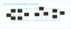
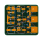
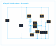
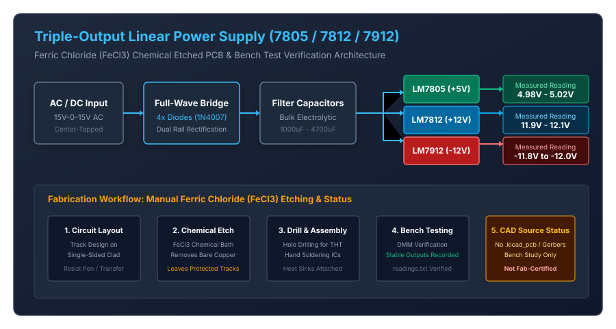

# PCB Design and Manufacturing Engineering

**Author:** Naraender S  
**License:** [MIT License](LICENSE)  

---

## 1. Overview and Project Scope

This repository documents my engineering work in printed circuit board (PCB) design, schematic capture, circuit calculations, and physical prototyping. It contains four hardware case studies developed using KiCad and practical laboratory fabrication methods:

1. **5V Regulated Through-Hole Power Supply (`designs/general-pcb-design`):** A single-sided linear DC power supply built with through-hole components (LM7805, 1N4007 bridge rectifier, and electrolytic filtering) designed for reliable hand assembly.
2. **Multi-Rail SMD Linear Power Supply (`designs/smd-pcb-design`):** A compact 2-layer surface-mount power distribution board designed to provide +5V, +12V, and -12V rails using TO-252 (DPAK) regulators. *Note: An audit identified a schematic power-rail short in the original design; manufacturing outputs are quarantined, and a preliminary Revision A schematic draft is provided.*
3. **ATtiny85 USB Breakout Dongle (`designs/usb-pcb-design`):** A standalone 2-layer USB development dongle based on the Microchip ATtiny85-20S microcontroller with PCB edge contacts for USB Type-A ports, 3.6V Zener level clamping, and breakout pin headers.
4. **Chemical-Etched Multi-Rail Power Supply Bench Study (`designs/linear-regulator-design`):** A hands-on prototyping project from a hardware workshop demonstrating manual single-sided PCB fabrication using ferric chloride ($FeCl_3$) chemical wet etching, with design calculations and recorded multimeter test readings.

---

## 2. Summary of Case Studies

| Case Study | Architecture / Function | Dimensions | Layer Count | Components | Status Summary | Documentation Link |
| :--- | :--- | :--- | :--- | :--- | :--- | :--- |
| **General THT PCB** | 5V 1.5A Regulated Linear Power Supply | 95.00 x 33.50 mm | 1 Copper Layer (`B.Cu`), 1.6 mm FR4 | 12 parts / 4 mounting holes | Schematic & layout complete; static clearances clean; native ERC/DRC and drill files pending | [Case Study 1 Readme](designs/general-pcb-design/README.md) |
| **SMD Multi-Rail PCB** | Triple-Output (+5V, +12V, -12V) SMD Supply | 33.50 x 30.00 mm | 2 Layers (`F.Cu`, `B.Cu`), 1.6 mm FR4 | 22 parts (DPAK, SMA, 0805) | Critical power-rail short identified; Gerbers quarantined; Revision A is an unverified draft | [Case Study 2 Readme](designs/smd-pcb-design/README.md) |
| **USB ATtiny85 PCB** | ATtiny85-20S USB Breakout Dongle (Standalone) | 40.00 x 12.20 mm | 2 Layers (`F.Cu`, `B.Cu`), 1.6 mm FR4 | 12 parts (SOIC-8, SOD-123) | Schematic & layout complete; static clearances clean; native ERC/DRC and hardware USB checks pending | [Case Study 3 Readme](designs/usb-pcb-design/README.md) |
| **Linear Regulator Bench** | Chemical-Etched (+5V, &plusmn;12V) Bench Prototype | ~100 x 60 mm (Bench) | 1 Layer (Copper-clad single-sided) | Discrete bench parts | Physical workshop prototype; multimeter test readings documented; no digital CAD files | [Case Study 4 Readme](designs/linear-regulator-design/README.md) |

---

## 3. Design Previews and Available Assets

### Case Study 1: 5V Regulated Through-Hole Power Supply
| PCB Layout Preview | Schematic Preview |
| :---: | :---: |
|  |  |

- Schematic: [designs/general-pcb-design/HARDWARE/Kicad-Hardware-Design.kicad_sch](designs/general-pcb-design/HARDWARE/Kicad-Hardware-Design.kicad_sch)
- PCB Layout: [designs/general-pcb-design/HARDWARE/Kicad-Hardware-Design.kicad_pcb](designs/general-pcb-design/HARDWARE/Kicad-Hardware-Design.kicad_pcb)
- Bill of Materials: [designs/general-pcb-design/BOM/bom.csv](designs/general-pcb-design/BOM/bom.csv)
- Bottom Copper Gerber: [designs/general-pcb-design/GERBER/Kicad-Hardware-Design-B_Cu.gbr](designs/general-pcb-design/GERBER/Kicad-Hardware-Design-B_Cu.gbr)

---

### Case Study 2: Multi-Rail SMD Linear Power Supply
| PCB Layout Preview | Schematic Preview |
| :---: | :---: |
|  |  |

- Schematic (Original): [designs/smd-pcb-design/HARDWARE/GitHub2.kicad_sch](designs/smd-pcb-design/HARDWARE/GitHub2.kicad_sch)
- PCB Layout (Original): [designs/smd-pcb-design/HARDWARE/GitHub2.kicad_pcb](designs/smd-pcb-design/HARDWARE/GitHub2.kicad_pcb)
- Bill of Materials: [designs/smd-pcb-design/BOM/bom.csv](designs/smd-pcb-design/BOM/bom.csv)
- Gerber Job File (Quarantined): [designs/smd-pcb-design/GERBER/GitHub2-job.gbrjob](designs/smd-pcb-design/GERBER/GitHub2-job.gbrjob)
- Corrected Draft Schematic: [designs/smd-pcb-design/revA_corrected/HARDWARE/GitHub2_revA_corrected.kicad_sch](designs/smd-pcb-design/revA_corrected/HARDWARE/GitHub2_revA_corrected.kicad_sch)
- Detailed Defect Analysis: [designs/smd-pcb-design/revA_corrected/README.md](designs/smd-pcb-design/revA_corrected/README.md)

---

### Case Study 3: ATtiny85 USB Breakout Dongle
| PCB Layout Preview | Schematic Preview |
| :---: | :---: |
|  |  |

- Schematic: [designs/usb-pcb-design/HARDWARE/USB.kicad_sch](designs/usb-pcb-design/HARDWARE/USB.kicad_sch)
- PCB Layout: [designs/usb-pcb-design/HARDWARE/USB.kicad_pcb](designs/usb-pcb-design/HARDWARE/USB.kicad_pcb)
- Bill of Materials: [designs/usb-pcb-design/BOM/bom.csv](designs/usb-pcb-design/BOM/bom.csv)
- Gerber Job File: [designs/usb-pcb-design/GERBER/USB-job.gbrjob](designs/usb-pcb-design/GERBER/USB-job.gbrjob)

---

### Case Study 4: Chemical-Etched Multi-Rail Power Supply Bench Study


- Design Calculations: [designs/linear-regulator-design/regulator-design/docs/calculations.md](designs/linear-regulator-design/regulator-design/docs/calculations.md)
- Circuit Working Principles: [designs/linear-regulator-design/regulator-design/docs/working.md](designs/linear-regulator-design/regulator-design/docs/working.md)
- Measured Multimeter Readings: [designs/linear-regulator-design/regulator-design/results/readings.txt](designs/linear-regulator-design/regulator-design/results/readings.txt)
- Etching Procedure: [designs/linear-regulator-design/pcb-etching/README.md](designs/linear-regulator-design/pcb-etching/README.md)

---

## 4. Tools, File Formats, and Verification Status

### Confirmed Tools and File Formats
- **KiCad 9:** Used for schematic capture (`.kicad_sch`) and board layout (`.kicad_pcb`).
- **Gerber Files:** Standard RS-274X copper layers (`.gbr`) and Gerber job manifests (`.gbrjob`).
- **Component Data:** Comma-separated Bill of Materials (`.csv`).
- **Vector Previews:** Scalable Vector Graphics (`.svg`) generated directly from CAD layout coordinates.
- **Documentation and Bench Data:** Markdown engineering notes (`.md`) and raw test logs (`.txt`).

### Verification Status and Known Limitations
- **SMD Board Power-Rail Short (Critical Defect):**
  - An unintentional vertical wire (UUID `b3812738-1a62-4d38-bef5-d9db1e02c554`) connects coordinate `(45.72, 35.56)` on the positive DC bus directly to `(45.72, 27.94)` on the 7805 return line in `designs/smd-pcb-design/HARDWARE/GitHub2.kicad_sch`.
  - This short ties regulator `U1` (L7805) input and ground together and shorts filter capacitor `C1`.
  - The board layout in `GitHub2.kicad_pcb` physically routes this shorted net.
  - **The associated manufacturing files are quarantined and must not be used for fabrication.**
  - A preliminary corrected schematic draft is provided in `revA_corrected/`. Excising the shorting wire leaves the 7805 return line floating relative to common ground; this draft remains unverified until connected in KiCad and re-routed on the PCB.
- **Native KiCad ERC and DRC Checks:**
  - KiCad was not installed in the review environment. Python static checks confirmed basic 2D Euclidean clearances between linear copper traces and circular pads, but these do not replace native KiCad Electrical Rules Check (ERC) or Design Rules Check (DRC).
  - Native KiCad ERC and DRC must be executed prior to any commercial manufacturing sign-off.
- **Manufacturing Deliverables:**
  - Complete drill files (`*.drl`), solder mask, and silkscreen Gerber layers are not present locally for the through-hole and USB boards.
- **ATtiny85 USB Dongle Considerations:**
  - The microcontroller uses an internal calibrated RC oscillator. Low-Speed USB 1.1 requires +/-1.5% frequency accuracy, which typically requires runtime software calibration against USB frame packets.
  - The PCB edge connector is designed on 1.60 mm FR4, which may fit loosely in standard USB-A ports (typically expecting a 2.0 mm to 2.4 mm plug tongue).
- **Chemical-Etched Power Supply:**
  - Preserved strictly as a documented hands-on workshop build with recorded multimeter readings; no digital CAD schematic or layout files exist in this repository.

A complete audit log of file hashes, clearance checks, and defect traces is documented in [docs/PORTFOLIO_VERIFICATION.md](docs/PORTFOLIO_VERIFICATION.md).

---

## 5. Repository Structure

```
01_PCB_Design_and_Manufacturing_Engineering/
|-- .gitignore                                    # Excludes editor caches, KiCad backups, and temporary files
|-- LICENSE                                       # MIT License (Naraender S 2025)
|-- README.md                                     # Main repository overview and index
|-- assets/                                       # Vector SVG previews for schematics and layouts
|   |-- general_pcb_layout.svg
|   |-- general_schematic.svg
|   |-- smd_pcb_layout.svg
|   |-- smd_schematic.svg
|   |-- usb_pcb_layout.svg
|   |-- usb_schematic.svg
|   `-- linear_regulator_architecture.svg
|-- docs/
|   `-- PORTFOLIO_VERIFICATION.md                 # Detailed engineering verification report
`-- designs/
    |-- general-pcb-design/                       # Case Study 1: 5V Through-Hole Linear Supply
    |   |-- .gitignore
    |   |-- LICENSE
    |   |-- HISTORICAL_NOTES.md
    |   |-- README.md
    |   |-- pcb_layout.svg & schematic.svg
    |   |-- BOM/bom.csv
    |   |-- GERBER/
    |   |   |-- Kicad-Hardware-Design-B_Cu.gbr
    |   |   `-- Kicad-Hardware-Design-job.gbrjob
    |   `-- HARDWARE/
    |       |-- Kicad-Hardware-Design.kicad_pcb
    |       `-- Kicad-Hardware-Design.kicad_sch
    |-- smd-pcb-design/                           # Case Study 2: Multi-Rail SMD Supply (Defect Documented)
    |   |-- HISTORICAL_NOTES.md
    |   |-- README.md
    |   |-- pcb_layout.svg & schematic.svg
    |   |-- BOM/bom.csv
    |   |-- GERBER/GitHub2-job.gbrjob             # Quarantined manufacturing file
    |   |-- HARDWARE/
    |   |   |-- GitHub2.kicad_pcb
    |   |   `-- GitHub2.kicad_sch
    |   `-- revA_corrected/                       # Unverified Revision A draft schematic
    |       |-- README.md
    |       `-- HARDWARE/GitHub2_revA_corrected.kicad_sch
    |-- usb-pcb-design/                           # Case Study 3: ATtiny85 USB Breakout Dongle
    |   |-- .gitignore
    |   |-- README.md
    |   |-- pcb_layout.svg & schematic.svg
    |   |-- BOM/bom.csv
    |   |-- GERBER/USB-job.gbrjob
    |   `-- HARDWARE/
    |       |-- USB.kicad_pcb
    |       `-- USB.kicad_sch
    `-- linear-regulator-design/                  # Case Study 4: Chemical-Etched Bench Prototype
        |-- HISTORICAL_NOTES.md
        |-- README.md
        |-- architecture.svg
        |-- pcb-etching/
        |   `-- README.md                         # Step-by-step chemical etching guide
        `-- regulator-design/
            |-- README.md
            |-- docs/calculations.md              # Circuit calculations and thermal formulas
            |-- docs/working.md                   # Stage-by-stage circuit operation
            `-- results/readings.txt              # Multimeter voltage readings
```

---

## 6. License

This project and all hardware designs, documentation, and test logs are licensed under the [MIT License](LICENSE).  
Copyright &copy; 2025 **Naraender S**.
