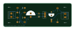

# Case Study 1: 5V Regulated Through-Hole Power Supply

**Design Type:** Linear DC Power Supply (Through-Hole)  
**CAD Tool:** KiCad 9  
**Status:** Schematic and PCB layout complete; static geometry checks clean; native KiCad ERC/DRC and complete drill files pending  

---

## 1. Overview and Design Purpose

In this project, I designed a 5V DC regulated linear power supply using through-hole technology (THT). The board converts an AC input from a step-down transformer or an unregulated DC input into a stable +5V DC rail suitable for breadboards, logic ICs, or microcontroller circuits.

I chose through-hole components (TO-220 package for the regulator, DO-41 for diodes, and radial lead capacitors) and single-sided copper routing on the bottom layer (`B.Cu`) so the board can be assembled easily by hand or fabricated using single-sided prototyping methods.

```
+------------+     +-------------------+     +------------------+     +-----------------+     +------------+
| AC/DC In   | --> | 4x 1N4007 Bridge  | --> | Bulk Filter      | --> | LM7805 TO-220   | --> | 5V Output  |
| Terminal   |     | Full-Wave Rect.   |     | Electrolytic Cap |     | Linear Reg. IC  |     | Terminal   |
+------------+     +-------------------+     +------------------+     +-----------------+     +------------+
                                                                             |
                                                                             v
                                                                      +-----------------+
                                                                      | LED Indicator   |
                                                                      +-----------------+
```

---

## 2. Circuit Stages and Operation

### Schematic Preview


The circuit consists of six functional stages:

1. **Input Interface (`J1`):** A 2-pin Phoenix Contact MKDS 1,5/2 horizontal screw terminal block (5.00 mm pitch) connects the AC secondary winding or unregulated DC input.
2. **Bridge Rectification (`D1`, `D2`, `D3`, `D4`):** Four 1N4007 silicon rectifier diodes (1A, 1000V) in DO-41 packages form a full-wave bridge rectifier. For AC input, two diodes conduct per half-cycle, producing pulsating DC with a total diode drop of approximately 1.4V.
3. **Filtering Network (`C1`, `C2`):**
   - `C1`: A 1000 uF radial electrolytic capacitor smooths low-frequency 100 Hz/120 Hz rectifier ripple.
   - `C2`: A 100 nF ceramic disc capacitor placed close to the regulator input filters high-frequency noise and prevents parasitic oscillation.
4. **Linear Voltage Regulation (`U1`):** An LM7805 fixed positive linear regulator in a TO-220-3 vertical package steps the filtered DC voltage down to +5V. It requires at least 7V input for proper regulation (2V dropout headroom).
5. **Output Filtering (`C3`):** A 100 uF electrolytic capacitor stabilizes the +5V output rail during load steps.
6. **Power Indicator (`D5`, `R1`):** A 5 mm flat-top LED in series with a 330 ohm axial resistor provides a visual indication that the 5V rail is powered.

---

## 3. PCB Layout and Mechanical Details

### PCB Layout Preview


- **Dimensions:** 95.00 mm x 33.50 mm (95.05 mm x 33.55 mm in Gerber profile).
- **Substrate:** Standard 1.60 mm FR4.
- **Copper Layers:** Single-sided routing on the Bottom Copper layer (`B.Cu`). Through-hole components mount on the top side (`F.Cu`).
- **Traces:** Standard signal and power traces with dedicated wide copper tracks for ground return.
- **Mounting:** 4 unplated 3.5 mm mounting holes located at the corners for chassis standoffs.

---

## 4. Verification Status and Limitations

- **Netlist Consistency:** All 12 electrical components in the schematic correlate directly with footprints in the PCB layout file.
- **Static Clearance Checks:** A custom Python geometry analysis of the KiCad file confirmed:
  - Minimum track-to-track clearance: 0.8607 mm (exceeds the 0.1524 mm / 6 mil baseline).
  - Minimum pad-to-track clearance: 0.6000 mm (measured to pad J2.2, which is circular and exact in linear segment scope).
  - No short circuits detected across distinct nets.
- **Important Limitations:**
  - Python static checks only evaluate linear 2D copper clearances; they do not replace native KiCad Electrical Rules Check (ERC) or Design Rules Check (DRC).
  - Native KiCad ERC and DRC have not been run in this environment because KiCad is not installed locally.
  - The local `GERBER/` folder contains only the bottom copper layer (`Kicad-Hardware-Design-B_Cu.gbr`) and the job file (`Kicad-Hardware-Design-job.gbrjob`). Drill files (`PTH.drl`, `NPTH.drl`), solder mask, and silkscreen layers are not present locally.
  - The board should not be sent for commercial manufacturing until native KiCad DRC is executed and a full manufacturing archive (drill and mask layers) is generated.

---

## 5. Bill of Materials

| Reference | Quantity | Value | Package / Footprint | Description |
| :--- | :--- | :--- | :--- | :--- |
| `C1` | 1 | 1000 uF | `Capacitor_THT:CP_Radial_D12.5mm_P5.00mm` | Bulk electrolytic filter capacitor |
| `C2` | 1 | 100 nF | `Capacitor_THT:C_Disc_D4.7mm_W2.5mm_P5.00mm` | High-frequency ceramic bypass capacitor |
| `C3` | 1 | 100 uF | `Capacitor_THT:CP_Radial_D8.0mm_P5.00mm` | Output stabilization capacitor |
| `D1, D2, D3, D4` | 4 | 1N4007 | `Diode_THT:D_DO-41_SOD81_P10.16mm_Horizontal` | 1000V 1A Silicon rectifier diodes |
| `D5` | 1 | LED | `LED_THT:LED_D5.0mm_FlatTop` | Power status indicator |
| `J1, J2` | 2 | Conn_01x02 | `TerminalBlock_Phoenix:MKDS-1,5-2_1x02_P5.00mm` | Input and output screw terminals |
| `R1` | 1 | 330 ohm | `Resistor_THT:R_Axial_DIN0411_L9.9mm_D3.6mm` | Current-limiting resistor for LED |
| `U1` | 1 | LM7805 | `Package_TO_SOT_THT:TO-220-3_Vertical` | Fixed +5V linear regulator |

---

## 6. Project Files

- Schematic: [HARDWARE/Kicad-Hardware-Design.kicad_sch](HARDWARE/Kicad-Hardware-Design.kicad_sch)
- PCB Layout: [HARDWARE/Kicad-Hardware-Design.kicad_pcb](HARDWARE/Kicad-Hardware-Design.kicad_pcb)
- Bill of Materials: [BOM/bom.csv](BOM/bom.csv)
- Gerber Job File: [GERBER/Kicad-Hardware-Design-job.gbrjob](GERBER/Kicad-Hardware-Design-job.gbrjob)
- Bottom Copper Gerber: [GERBER/Kicad-Hardware-Design-B_Cu.gbr](GERBER/Kicad-Hardware-Design-B_Cu.gbr)
- Historical Design Notes: [HISTORICAL_NOTES.md](HISTORICAL_NOTES.md)
