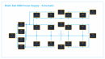

# Case Study 2: Multi-Rail SMD Linear Power Supply

**Design Type:** Multi-Rail Linear Power Distribution (Surface-Mount)  
**CAD Tool:** KiCad  
**Status:** Defect identified during audit; manufacturing outputs quarantined; Revision A is an unverified draft schematic  

---

## 1. Overview and Design Purpose

This project is a surface-mount power supply board designed to deliver three regulated DC voltage rails: +5V, +12V, and -12V in a compact 33.5 mm x 30.0 mm footprint. The intended architecture takes a dual-polarity center-tapped AC transformer input or dual-polarity DC input to drive:
- An **L7805** regulator for a +5V logic rail
- An **L7812** regulator for a +12V analog/relay rail
- An **L7912** regulator for a -12V negative rail (such as for dual-supply operational amplifiers)

All three regulators use surface-mount DPAK (TO-252) packages, paired with SMA rectifier diodes and SMD electrolytic capacitors to keep the board compact.

---

## 2. Circuit Architecture and Schematics

### Schematic Preview

The schematic uses a 3-pin input header (`J1`), a 4-diode rectifier bridge (`D1`–`D4`), bulk filter capacitors (`C1`, `C2`, `C3`), high-frequency ceramic bypass capacitors (`C4`, `C5`, `C6`), three linear regulators (`U1`, `U2`, `U3`), output filter capacitors (`C7`–`C12`), and JST-PH output headers (`J2`, `J3`).

---

## 3. PCB Layout Architecture

### PCB Layout Preview

- **Dimensions:** 33.50 mm x 30.00 mm (finished profile 33.55 mm x 30.05 mm)
- **Layer Count:** 2 copper layers (`F.Cu`, `B.Cu`)
- **Substrate Thickness:** 1.60 mm FR4
- **Vias:** 16 interlayer vias (0.60 mm pad diameter, 0.30 mm finished drill hole)

---

## 4. Defect Analysis: Power-Rail Short Circuit

During an engineering audit of the design files, a critical schematic drafting mistake was identified that propagated directly into the PCB layout:

### Description of the Defect
In the original schematic file (`HARDWARE/GitHub2.kicad_sch`), an unintended vertical wire segment was drawn at `x=45.72` between `y=35.56` and `y=27.94` (UUID `b3812738-1a62-4d38-bef5-d9db1e02c554`):
- Point `(45.72, 35.56)` lies on the unregulated positive DC rail feeding regulator `U2` (L7812) from diode bridge cathodes `D1`/`D3`.
- Point `(45.72, 27.94)` lies on the ground return line for regulator `U1` (L7805).
- Because this vertical wire connected the two lines, KiCad merged the unregulated positive rail and the 7805 return line into a single net: `Net-(D1-K)`.

### Impact on Layout and Physical Circuit
1. **Regulator `U1` (L7805):** Pin 1 (Vin) and Pin 2 (GND) are shorted together on the same net.
2. **Capacitor `C1` (Bulk Filter):** Both positive and negative terminals are connected to `Net-(D1-K)`, shorting the capacitor across its terminals.
3. **Capacitor `C4` (Ceramic Bypass):** Both terminals are tied to `Net-(D1-K)`.
4. **Output Capacitors `C7` and `C10`:** Ground return terminals are tied to raw positive DC rather than common ground.
5. **Connector `J2` (5V Output):** Pin 2 (return) is tied to raw positive DC.
6. **Rectifier Stage:** Diodes `D1` and `D3` discharge directly into the 7805 return line.

### Manufacturing and Safety Impact
If this board were fabricated and powered as routed:
- It would present a direct dead short across the rectified DC power source.
- Diodes would fail from overcurrent, copper traces could burn, or the power supply would trigger overcurrent protection.
- **Quarantine Notice:** The Gerber files in `GERBER/` are **quarantined and must not be used for fabrication**.

---

## 5. Revision A Draft and Current Status

To preserve the authentic historical design files, the original schematic and PCB files in `HARDWARE/` remain completely unchanged.

A preliminary corrected schematic is provided in `revA_corrected/`:
- **File:** [revA_corrected/HARDWARE/GitHub2_revA_corrected.kicad_sch](revA_corrected/HARDWARE/GitHub2_revA_corrected.kicad_sch)
- **Detailed Documentation:** [revA_corrected/README.md](revA_corrected/README.md)
- **Change Made:** The vertical shorting wire (UUID `b3812738-1a62-4d38-bef5-d9db1e02c554`) was excised, restoring the continuous positive rail feeding `U2`.

### Remaining Unresolved Issues in Revision A
1. **Floating Return Rail:** Excising the shorting wire eliminates the dead short, but leaves the 7805 return rail (`y=27.94`) completely floating with no electrical connection to the Common Ground rail (`y=49.53`).
2. **PCB Layout Unchanged:** Modifying the schematic does not automatically reroute the copper traces in `HARDWARE/GitHub2.kicad_pcb`. The physical board layout still contains shorted copper traces.
3. **Draft Status:** Revision A is an **unverified draft**. Before this board can be fabricated, the return rail must be connected to ground in KiCad, traces must be rerouted in the PCB editor, and native ERC and DRC checks must pass.

---

## 6. Bill of Materials

| Reference | Quantity | Value | Package / Footprint | Description |
| :--- | :--- | :--- | :--- | :--- |
| `C1, C2, C3, C7, C8, C9` | 6 | Polarized Cap (SMD) | `Capacitor_SMD:CP_Elec_6.3x5.8` | Bulk filtering per voltage rail |
| `C4, C5, C6, C10, C11, C12` | 6 | Ceramic Cap (SMD) | `Capacitor_SMD:C_0805_2012Metric` | High-frequency bypass per rail |
| `D1, D2, D3, D4` | 4 | 1N4007 (SMD) | `Diode_SMD:D_SMA` | 1A 1000V Rectifier diodes |
| `J1, J3` | 2 | Conn_01x03 | `Connector_JST:JST_PH_S3B-PH-SM4-TB_1x03` | 3-pin JST-PH power interface |
| `J2` | 1 | Conn_01x02 | `Connector_JST:JST_PH_S2B-PH-SM4-TB_1x02` | 2-pin JST-PH 5V output interface |
| `U1` | 1 | L7805 | `Package_TO_SOT_SMD:TO-252-2` | +5V SMD linear regulator (DPAK) |
| `U2` | 1 | L7812 | `Package_TO_SOT_SMD:TO-252-2` | +12V SMD linear regulator (DPAK) |
| `U3` | 1 | L7912 | `Package_TO_SOT_SMD:TO-252-2` | -12V SMD linear regulator (DPAK) |

---

## 7. Project Files

- Original Schematic: [HARDWARE/GitHub2.kicad_sch](HARDWARE/GitHub2.kicad_sch)
- Original PCB Layout: [HARDWARE/GitHub2.kicad_pcb](HARDWARE/GitHub2.kicad_pcb)
- Bill of Materials: [BOM/bom.csv](BOM/bom.csv)
- Gerber Job File (Quarantined): [GERBER/GitHub2-job.gbrjob](GERBER/GitHub2-job.gbrjob)
- Historical Design Notes: [HISTORICAL_NOTES.md](HISTORICAL_NOTES.md)
- Corrected Revision A Draft: [revA_corrected/README.md](revA_corrected/README.md)
